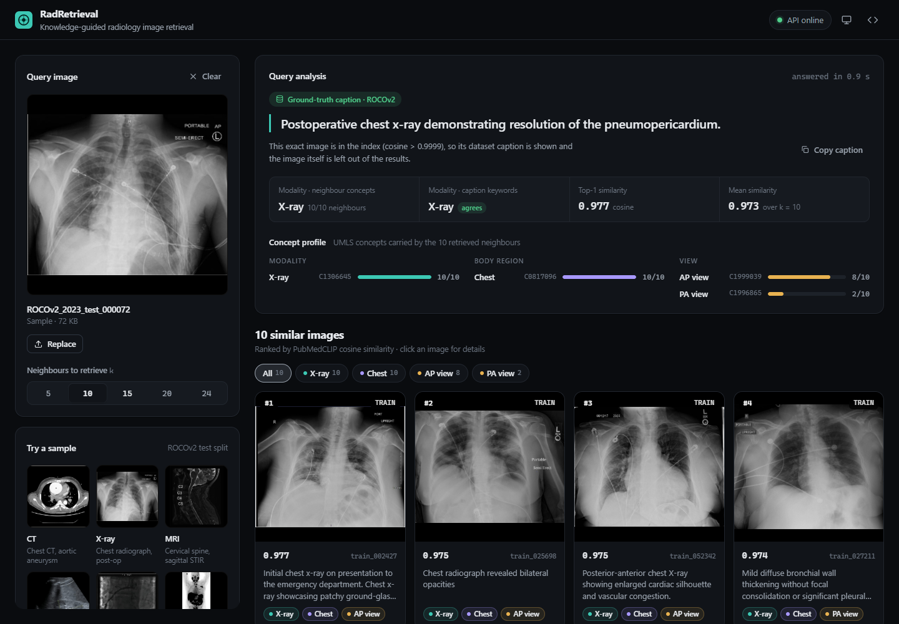
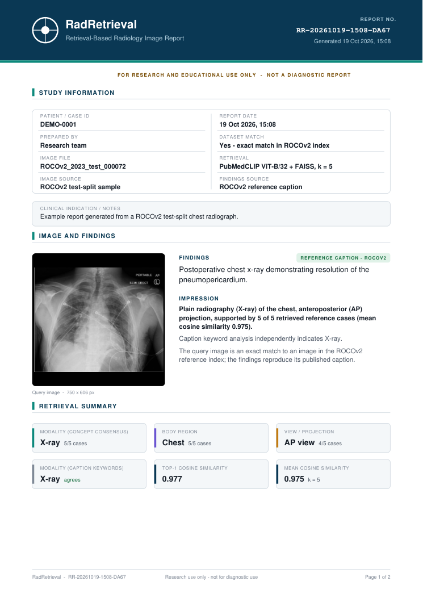
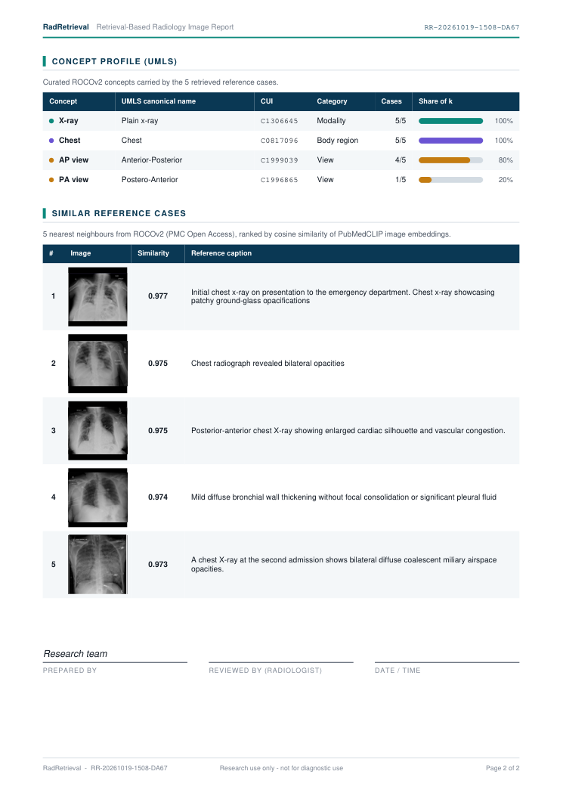

# RadRetrieval — knowledge-guided radiology image retrieval

Web frontend for a content-based radiology image retrieval system built on **ROCOv2**. Upload a scan (or pick a sample) and it:

1. embeds the image with **PubMedCLIP** (ViT-B/32),
2. retrieves the nearest neighbours from a **FAISS** index of 80,080 ROCOv2 images,
3. shows the **ground-truth caption** when the image is in the dataset, otherwise a caption generated by **BLIP-ROCO**,
4. pools the neighbours' curated **UMLS concepts** (modality, body region, view) into a concept profile and a modality consensus.



The backend is a FastAPI service hosted on Hugging Face Spaces: [`saad003/rad-retrieval-api`](https://huggingface.co/spaces/saad003/rad-retrieval-api).

## Features

- Drag-and-drop, file picker, or paste an image from the clipboard (`Ctrl+V`)
- Six one-click samples from the ROCOv2 test split (CT, X-ray, MRI, ultrasound, angiography, PET)
- Choose how many neighbours to retrieve (k = 5–24)
- Query analysis: caption source (ground truth vs. generated), modality from neighbour concepts vs. the backend's caption keyword rule, top-1 / mean cosine similarity
- Concept profile: how many of the k neighbours carry each UMLS concept, with official ROCOv2 concept names
- Filter results by concept
- Detail view with full caption, concepts and CUIs; browse with arrow keys; **"Search with this image"** to pivot the query
- **Downloadable PDF report** in a radiology-report layout (see below)
- Recent queries for the session
- If the Space is asleep or unreachable, a notice appears and the app retries automatically
- Light / dark / system theme, responsive down to phone width, keyboard accessible

## Radiology report (PDF)

After a search, **Generate report** opens a live preview of an A4 PDF that you can download. It's built entirely in the browser with jsPDF, and nothing you type into the form is uploaded. The report contains:

1. **Study information**: patient/case ID, prepared by, image file and source, date, dataset match, retrieval settings, findings source, plus optional clinical indication/notes
2. **Image and findings**: the query image, the caption (labelled as the ROCOv2 reference caption or an AI-generated caption), and an impression derived from the retrieved cases' concepts
3. **Retrieval summary**: modality, body region and view by concept consensus, the caption-keyword modality (with agreement), and top-1 and mean similarity
4. **Concept profile (UMLS)**: each concept with its canonical name, CUI, category and share of the k cases
5. **Similar reference cases**: rank, thumbnail, case ID and split, similarity, caption and concepts
6. **Sign-off** lines, with running headers, page numbers and a "research use only" footer

Case ID and notes reset for each new image. "Prepared by" is kept for the session.

| Page 1 | Page 2 |
| ------ | ------ |
|  |  |

## Run locally

Requires Node.js 20+.

```bash
git clone https://github.com/muhammadsaad003/kgbasedretrival.git
cd kgbasedretrival
npm install
npm run dev
```

Open http://localhost:5173.

| Command             | What it does                                 |
| ------------------- | -------------------------------------------- |
| `npm run dev`       | Start the dev server with hot reload         |
| `npm run build`     | Type-check and build static files to `dist/` |
| `npm run preview`   | Serve the production build locally           |
| `npm run typecheck` | Type-check only                              |

### Pointing at a different backend

By default the app calls `https://saad003-rad-retrieval-api.hf.space`. To use another backend (for example one running locally on port 7860), copy `.env.example` to `.env` and set:

```bash
VITE_API_URL=http://localhost:7860
```

Restart `npm run dev` after changing it.

## API contract

`POST /search_by_image?k=<int>` with multipart field `file` returns:

```jsonc
{
  "query_caption": "CT chest axial view showing ...",
  "modality": "CT",               // backend keyword rule on the caption
  "is_dataset_image": true,       // exact match (cosine > 0.9999) → ground-truth caption
  "results": [
    {
      "ID": "ROCOv2_2023_test_003672",
      "split": "test",
      "caption": "...",
      "concepts_manual": "C1306645;C0817096;C1999039",
      "score": 0.979,             // cosine similarity
      "image_url": "https://huggingface.co/datasets/saad003/images04/resolve/main/test/..."
    }
  ],
  "scores": { ... }               // not displayed, see below
}
```

`GET /` is used as the health check.

## Notes on the backend

- The `scores` object (`modality_score`, `cui_at_k`, `bertscore`, `medbertscore`) comes from `generate_random_scores()` in `app.py`, so it is random rather than measured. The UI does not show it. Instead it shows statistics computed from the actual results.
- The caption keyword rule uses substring matching, so it can misfire (for example "rec**ta**l artery" matches `cta` → "CT") or miss phrasing like "CT chest". The UI therefore also shows the modality agreed on by the neighbours' curated concepts and flags disagreements.
- 733 metadata rows have an empty `concepts_manual`. pandas reads these as `NaN`, which Starlette's JSON encoder rejects, so the request fails with HTTP 500 whenever such a row is retrieved (mostly PET/CT images). The UI shows a clear error. The fix belongs in `search_similar_from_feats` in `app.py`:

  ```python
  rows["concepts_manual"] = rows["concepts_manual"].fillna("")
  ```

## Project structure

```
src/
  api.ts              API client, validation, types
  concepts.ts         The 18 ROCOv2 UMLS concepts, parsing and aggregation
  report.ts           PDF report builder (jsPDF + autotable, lazy-loaded)
  reportInfo.ts       Report IDs, file names and form fields
  samples.ts          Sample images
  hooks.ts            API status, theme, dialogs, timers, clipboard
  App.tsx             State and layout
  components/         Header, QueryPanel, Analysis, Results, Lightbox, ReportDialog, States, icons
  styles.css          Design tokens and styles (light and dark)
```

## Data and licences

Images and captions are from [ROCOv2](https://doi.org/10.5281/zenodo.10821435) (PMC Open Access subset), licensed CC BY-NC-SA 4.0. Concept names come from ROCOv2's `cui_mapping.csv`.

**Research prototype. Not a medical device and not for diagnostic use.**
